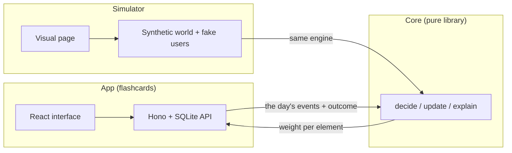
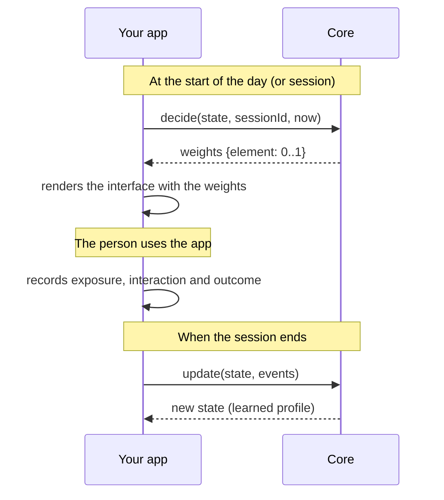
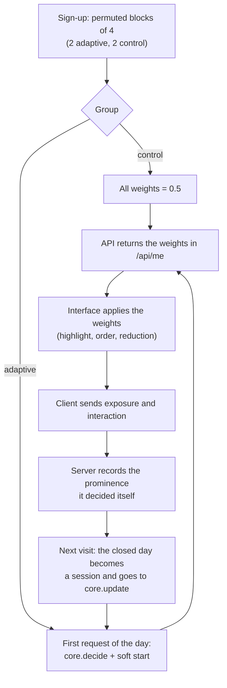

**English** | [Português](README.md)

# Adaptive gamification

A library, an app and a simulator for researching **adaptive gamification**: gamified interfaces that adjust to each person based on what they do, with no profile questionnaire.

> **Status:** research in progress. The engine and the simulator are finished and tested; the simulator's numbers come from a **synthetic world** and are not evidence about real people. That will be tested with the app, in an A/B experiment (off by default).
>
> **Language note:** this README is available in English and [Portuguese](README.md). The code, comments and identifiers are in English; the app's interface is in Brazilian Portuguese.

## What is adaptive gamification?

**Gamification** is the use of game elements (points, levels, leaderboards, challenges, groups…) outside games, to encourage a behavior such as studying every day. The catch is that **one gamification for everyone works poorly**: what motivates one person can leave another indifferent or annoyed.

**Adaptive gamification** changes the gamified interface for each person. The central question is: *which elements should be shown, and how prominently, to this person?*

### The Hexad typology

We build on the **Hexad** typology of gamification user types (proposed by Andrzej Marczewski and turned into a measurement scale by Tondello and colleagues). It describes six motivations:

| Type | Main motivation | Typical elements |
|---|---|---|
| **Achiever** | Mastery, competence, progress | levels, mastery bars, challenges, achievements |
| **Player** | Rewards and gains | points, leaderboard, rewards |
| **Socialiser** | Relating to other people | groups, activity feed, pair study |
| **Free Spirit** | Autonomy and exploration | catalog to explore, free learning paths, personalization |
| **Disruptor** | Changing the system | create and remix, vote on features, suggest edits |
| **Philanthropist** | Helping others with no expected return | sharing, answering questions, gifting |

### What this project does differently

1. **The profile is a vector of 6 numbers, not a label.** A person is not "an Achiever": they have a mix, which the system estimates and keeps updating.
2. **No questionnaire.** The profile is learned from behavior: what was shown, what the person interacted with, and whether they did what the app wants to encourage.
3. **The reward is the app's target behavior** (here, finishing the day's study queue), not clicks. Clicks enter only as a small auxiliary signal.
4. **It learns and forgets.** It is a contextual bandit (linear Thompson Sampling) with forgetting, so it follows changes of taste, slowly.
5. **It never hides an element.** The engine returns weights from 0 to 1 with a floor; the app decides what to do with them (highlight, reorder, shrink).

## What we deliver

| Part | What it does | Where |
|---|---|---|
| **Core** | A pure TypeScript library (no I/O, no dependencies). It receives usage events and returns, each day, the weight of every gamification element for that person | [`packages/core`](packages/core) |
| **App** | "Estudo com cartões" (Study with cards): a flashcard app with spaced repetition, 19 gamification elements (individual and social) and an optional A/B experiment in which the adaptive group uses the core | [`packages/app-server`](packages/app-server), [`packages/app-web`](packages/app-web) |
| **Simulator** | Synthetic users with hidden Hexad preferences, to measure whether the engine learns, plus an interactive page that shows the interface changing over the days | [`packages/simulator`](packages/simulator) |

> The app's interface is in Brazilian Portuguese.



## Contents

1. [Core](#1-core)
2. [App](#2-app)
3. [Simulator](#3-simulator)

**Requirements:** Node.js 24 or newer (the project runs TypeScript directly, with no build step, and uses Node's built-in SQLite). After cloning: `npm install`.

---

## 1. Core

The core is the adaptation engine. It is a **pure** library: no network, no disk, no clock, no dependencies, and no knowledge of any app. You store one small JSON object per user (the *state*) and call functions that return a new state.

### How it works



Internally, for each person the core keeps a **belief** about their Hexad profile (6 numbers, with uncertainty). In `decide` it samples a plausible profile from that belief and scores each element by its **Hexad signature** (how much it speaks to each type); the score becomes a weight between the floor and 1. In `update` it adjusts the belief based on which mix of elements the person saw and what the outcome was. Forgetting slowly pulls the belief back to the neutral point when there is no new evidence..

Model summary (the belief is `θ ~ N(μ, Σ)`, stored as `A = Σ⁻¹` and `b = Aμ`; `x` is the mix of the normalized signatures of the displayed elements, weighted by prominence; `r` is the session reward):

```text
decide:  θ̃ = μ + v · chol(Σ) · z,   z ~ N(0, I)             v = samplingScale
         s_e = θ̃ · signature_e
         weight_e = clamp(0.5 + sensitivity · (s_e − mean(s)), exposureFloor, 1)
update:  A ← γA + x xᵀ / σ² + (1−γ) Λ₀                      γ = forgetting, σ² = noiseVariance
         b ← γb + r x / σ² + (1−γ) Λ₀ μ₀
         r = (1−ω) · outcome + ω · interaction_rate          ω = interactionRewardWeight
```

In the reward, the *level* (mean of the six dimensions) acts as an intercept (nearly diffuse prior), so what is learned is the **difference** between the types.

### Using it in a project

The core is **not on npm yet**. For now, copy the [`packages/core/src`](packages/core/src) folder (6 files, about 750 lines, no dependencies) or use the repository as a submodule, and import it by relative path. Node 24+ and modern bundlers (Vite, esbuild) read the `.ts` files directly.

A runnable example is in [`packages/core/examples/quickstart.ts`](packages/core/examples/quickstart.ts):

```bash
node packages/core/examples/quickstart.ts
```

The steps, in short:

```ts
import { applySoftStart, createEngine, softStartFactor } from './packages/core/src/index.ts';
import type { AdaptiveEvent, Catalog } from './packages/core/src/index.ts';

// 1. The catalog: your gamification elements and the Hexad "signature" of each one.
const catalog: Catalog = {
  schemaVersion: '0.1',
  elements: [
    { id: 'points', label: 'Points', signature: { achiever: 0.2, player: 0.6, socialiser: 0.05, freeSpirit: 0.05, disruptor: 0.05, philanthropist: 0.05 } },
    { id: 'study_groups', label: 'Groups', signature: { achiever: 0.05, player: 0.1, socialiser: 0.6, freeSpirit: 0.05, disruptor: 0.05, philanthropist: 0.15 } },
    // ...
  ],
};

// 2. The engine (one per catalog). `seed` makes decisions reproducible.
const engine = createEngine({ schemaVersion: '0.1', catalog, seed: 1 });

// 3. The person's state: a JSON object. Create it at sign-up and store it (database, file...).
let state = engine.neutralState('user-1');

// 4. Decide. Idempotent per sessionId: calling again returns the same weights.
const day = 0;
const decided = engine.decide(state, 'day-0', Date.now()).weights;
// Optional, recommended: in the first days, shrink the weights toward 0.5 (see "Soft start").
const weights = applySoftStart(decided, softStartFactor(day, 7));
// -> render the interface: weights['points'] = 0.72 (highlighted), weights['study_groups'] = 0.1 (reduced)...

// 5. When the session ends, report what really happened and learn.
const events: AdaptiveEvent[] = [
  { type: 'exposure', userId: 'user-1', sessionId: 'day-0', at: Date.now(), elementId: 'points', prominence: weights['points']! },
  { type: 'interaction', userId: 'user-1', sessionId: 'day-0', at: Date.now(), elementId: 'points' },
  { type: 'outcome', userId: 'user-1', sessionId: 'day-0', at: Date.now(), value: 0.8 }, // the behavior you want to encourage, from 0 to 1
];
state = engine.update(state, events).state; // returns a NEW state; the old one is not changed
```

### API

```ts
createEngine(config: EngineConfig): AdaptiveEngine
```

| Method | When to call | What it does |
|---|---|---|
| `neutralState(userId)` | at sign-up | Neutral initial state: no profile assumed (the six dimensions equal), with high uncertainty |
| `decide(state, sessionId, at)` | at the start of each session | Returns `{ weights, state, reused }`. Weights in `[exposureFloor, 1]`. **Idempotent per `sessionId`** |
| `update(state, events)` | when sessions end | Learns from **complete sessions** (exposure + interaction + outcome in the same batch). Returns `{ state, processedSessions, skippedSessions, warnings }`. Idempotent per `sessionId` |
| `explain(state)` | for debugging or display | `{ profile, level, uncertainty, sessionsObserved }`: estimated profile (differences between the 6 types), mean reward level and uncertainty |

**Events** (`AdaptiveEvent`), all with `userId`, `sessionId` and `at` (milliseconds):

| `type` | Fields | Meaning |
|---|---|---|
| `exposure` | `elementId`, `prominence` (0 to 1) | The element was **actually displayed**, with this prominence. It defines the session context; record what was shown, not only what was decided |
| `interaction` | `elementId` | The person interacted with the element (auxiliary signal, small weight) |
| `outcome` | `value` (0 to 1), `kind?` | The app's target behavior in this session, e.g. the fraction of the study queue finished |

**Configuration** (`EngineConfig`): only `schemaVersion`, `catalog` and, preferably, `seed` are required. The defaults were calibrated in the simulator (see `calibrate.ts` in `packages/simulator/src`); the full list is in [`types.ts`](packages/core/src/types.ts) and `DEFAULTS`.

| Parameter | Default | Effect |
|---|---|---|
| `forgetting` | 0.98 | How much the belief forgets per session. Lower = follows changes faster, with more noise |
| `sensitivity` | 16 | How far from 0.5 the weights go for a given score difference. Higher = more contrasted interface |
| `exposureFloor` | 0.1 | No element goes below this |
| `samplingScale` | 0.15 | How much the sampling explores. Low = nearly greedy and stable |
| `interactionRewardWeight` | 0.05 | Weight of clicks in the reward (the rest is the `outcome`) |
| `priorVariance`, `levelPriorVariance`, `noiseVariance` | 0.5; 100; 0.05 | Model prior and noise |
| `seed` | 0 | Seed of the deterministic generator |

### Good practices and caveats

- **Record what was shown.** `exposure` must reflect the actual interface, including when you smooth or cap the weights.
- **Choose the `outcome` carefully.** The engine optimizes whatever you send. Use the behavior you want to encourage, not clicks.
- **Soft start.** Even with a neutral belief, the first sampled decision can be extreme (several elements at the maximum and several at the floor). `softStartFactor` and `applySoftStart` shrink the weights toward 0.5 in the first days, growing from 25% to 100%. This is app policy, not part of the engine.
- **Serializable state.** `UserState` is plain JSON; store it however you like. The formats have JSON Schemas in [`spec/schemas`](spec/schemas) to validate input and output.
- **Determinism.** The same state, seed and events always give the same result, which keeps tests simple.
- **Your catalog, your signatures.** Hexad signatures are *priors* from the literature and the team's judgment, not ground truth. See the example catalog in [`spec/catalog.flashcards.json`](spec/catalog.flashcards.json). Different variants of the same strategy should be different elements.
- **Known limit:** following a change of taste is slow (tens of days), and one person's history is noisy. See the simulator section.

```bash
npm test             # core, app and simulator (107 tests)
npx tsc -p tsconfig.json   # type check
```

---

## 2. App

**"Estudo com cartões"** is a flashcard web app used as a real research environment: it has a clear goal (study every day), a measurable behavior (finishing the day's queue) and many gamification elements that can be highlighted or reduced.

### What it does

- **Study:** spaced repetition (simplified SM-2, grades Again/Hard/Good/Easy), up to 10 new cards per day spread across decks, studying in two steps (choose decks, then study).
- **Library:** sample public decks; create, remix, free learning paths, explore the catalog.
- **19 gamification elements**, three or more for each Hexad type:

| Type | Elements |
|---|---|
| Achiever | levels, mastery bar per deck, daily challenges, achievements |
| Player | points, weekly leaderboard, cosmetic rewards |
| Socialiser | study groups, activity feed, pair study |
| Free Spirit | explore the catalog, non-linear paths, avatar and theme |
| Disruptor | create and remix decks, vote on features, suggest edits |
| Philanthropist | share decks, answer questions, gift peers |

- **No punishment:** no element takes away points, streak or level.
- **Research:** logs exposure and interaction events, with anonymized CSV export.
- **Pseudonymous access:** a generated code plus an optional password. No e-mail or real name.

### How to run

```bash
npm install
npm run build:web    # builds the interface (once, and after changing the front end)
npm run start        # http://localhost:8787
```

On Windows, use `npm.cmd` if PowerShell blocks scripts, or double-click `iniciar.bat`. For development, `npm run dev:server` and `npm run dev:web` restart on save.

| Variable | Default | Purpose |
|---|---|---|
| `PORT` | 8787 | Server port |
| `DATA_PATH` | `./data/app.db` | SQLite database file (created on first run, with sample content) |
| `EXPERIMENT` | off | `on` enables the A/B experiment with adaptive gamification |
| `ENGINE_SEED` | 1 | Engine seed |
| `RAMP_DAYS` | 7 | Soft-start days for the adaptive group (1 turns it off) |
| `SECURE_COOKIES` | off | `1` when running behind HTTPS |

Other commands: `npm run export` (anonymized research events in `data/export/`) and `npm run admin -- proposals|suggestions` (most voted ideas and edit suggestions).

### How it connects to the core

With the experiment **off** (default), everyone sees the same interface, with every weight at 0.5. With `EXPERIMENT=on`:



Design points that matter for the research:

- **The unit of adaptation is the study day.** The decision is made on the first request of the day and holds for all visits.
- **The outcome is the fraction of the queue finished** that day, credited to the day's first session.
- **The server decides and records the prominence.** The client cannot forge exposure, and **never receives its own group**.
- **If the core fails**, the person gets uniform weights and the app keeps working.
- **Weights become interface:** weight ≥ 0.7 is highlighted (border, comes first in the grid); ≤ 0.3 is reduced (title and "Ver detalhes" only, never disappears); in between is normal. Order follows weight. The rule lives in [`presentation.ts`](packages/app-web/src/presentation.ts), shared with the simulator.

### What is the impact of adaptive gamification in this app?

The impact is **what changes on screen**, and what we expect from it is a **hypothesis to test**:

| | Control group | Adaptive group |
|---|---|---|
| Interface | The same for everyone | Each person sees highlighted the elements the engine estimates fit them, with the rest reduced |
| What changes | Nothing | Which elements are highlighted, in what order, and which are compact; changes from one day to the next |
| Data collected | Exposure, interaction, daily outcome | The same, plus the estimated profile and uncertainty day by day |
| What is compared | Finishing the day's queue, retention, usage | Same |

In the simulator, in a world where the fit between element and profile matters by construction, the expected gain over the uniform interface is **about 5 percentage points** of completion (from 42% to 47%), against 12 points for an oracle that knows the profile. This shows the mechanism works *if the effect exists*; it does **not** show that the effect exists in real people. That is what the experiment (with ethics approval) will measure.

Limitations to keep in mind: social elements are only shown to people who open the Community tab (position bias); the adaptive group uses a 7-day soft start; and the engine's parameters were calibrated only on synthetic worlds and should be re-estimated with pilot data.

---

## 3. Simulator

The simulator answers a question before anyone uses the app: **given a user with hidden Hexad preferences, can the engine discover them from noisy signals and improve the outcome?** It uses the same core as the app.

### What it does

- **Synthetic world** ([`sim.ts`](packages/simulator/src/sim.ts)): each fake user has a hidden affinity for each Hexad type and a base chance of finishing the queue. The day's interface shifts that chance according to how well it fits the affinity, with daily noise. Some "shiny" elements attract clicks without improving the outcome, to test the trap of optimizing for clicks.
- **Policies compared:** uniform (control), random, oracle (knows the profile), Hexad (the core) and a direct bandit over the elements, with the same seeds and the same noise for a fair comparison.
- **F2 experiments** (`npm run sim`): checks the project's six acceptance criteria and writes a report.
- **Calibration** ([`calibrate.ts`](packages/simulator/src/calibrate.ts)): parameter search with validation on worlds the search never saw.
- **Visual page:** one fake user living days in the app, with time control.

### How to use it

```bash
npm install
npm run sim          # F2 experiments (300 users per policy); SIM_USERS=60 for a quick run
                     # writes the report to docs/SIMULACAO_F2_RESULTADOS.md (local, unversioned folder)
node packages/simulator/src/calibrate.ts   # calibration (CAL_QUICK=1 for a quick test); writes docs/CALIBRACAO_F2_RESULTADOS.md (local)
npm run sim:web      # visual page at http://localhost:5174 (or double-click iniciar-simulacao.bat)
```

**The visual page** lets you:

- pick the fake user (a ready-made Hexad profile or any mix) and tune the world (interface effect, noise, base chance, duration, soft start);
- **control time**: play, pause, step by step, +7 days, drag the bar and speed up from 1 to 40 days per second;
- see the **adaptive interface side by side with the uniform one**, with highlighted, normal and reduced elements, and which ones the user clicked;
- compare the **hidden real affinity** with the **profile the system estimated**;
- see the weight of each element across all days (heat map);
- simulate a **change of taste** midway;
- simulate **30 lives** of the same user and see the average, because one person's history is noisy.

### What it tells you

Results with the calibrated defaults, 300 synthetic users per policy, 120 days (`npm run sim` reproduces them and writes the full report):

| Question | Answer |
|---|---|
| Does the engine learn the profile starting from neutral? | **Yes.** Mean correlation with the hidden profile of ≈ 0.6 on day 120; the dominant type is identified in 62% of cases (chance: 17%) |
| Does it improve the outcome? | **Yes, on average.** Gain of ≈ 0.049 over the uniform interface (the oracle reaches 0.123). The gap to the oracle comes from the cost of learning and from noise |
| Does it follow a change of taste? | **Partly and slowly.** Tens of days to recover part of the correlation |
| Is optimizing for clicks a good idea? | **No.** With clicks as the only reward, the outcome gain drops from 0.050 to 0.012 |
| Does any element disappear? | **No.** The floor is respected in every decision |
| Is the Hexad layer worth it? | **It depends on the world.** It beats a direct bandit when Hexad structure exists, even with imprecise signatures; it loses when each element's individual effect is strong |
| How much does the interface change per day? | On average 0.16 of weight per element; it is visible. Reducing it costs gain |

**How to read it:** we defined the world ourselves, and in it the Hexad effect exists by construction. The numbers check the **behavior of the algorithm**, not the behavior of people. They do not cover novelty effects, dropout, gradual taste change or more than one session per day.

To extend it: add new policies in `sim.ts` (`PolicyFactory`), change the world parameters (`WorldParams`) or swap the catalog in [`spec/`](spec).

---

## Repository layout

| Folder | Contents |
|---|---|
| `packages/core/` | The engine, example and tests |
| `packages/app-server/` | API, database, spaced repetition, gamification, experiment |
| `packages/app-web/` | React interface |
| `packages/simulator/` | Synthetic world, experiments, calibration and visual page |
| `spec/` | JSON Schemas, flashcard catalog and event examples |

## Commands

```bash
npm install
npm test             # 107 tests (core, app, simulator)
npx tsc -p tsconfig.json
npm run sim          # simulator experiments
npm run sim:web      # visual page
npm run build:web && npm run start   # app
npm run export       # export the research events
```

## License

Code under the [MIT](LICENSE) license.

The simulator's results come from a synthetic world; see the caveats in the [Simulator](#3-simulator) section before citing them.
