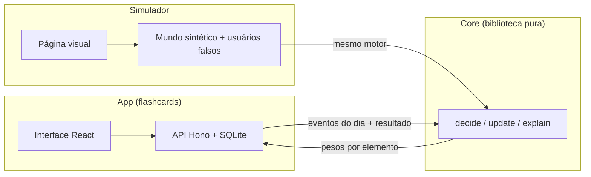
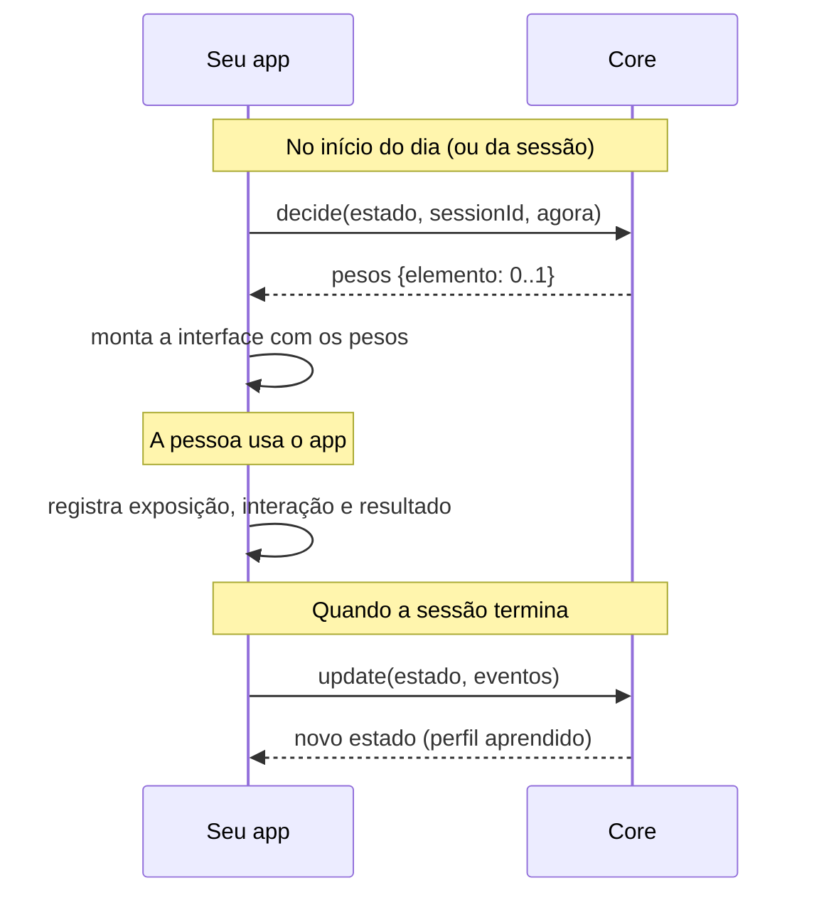
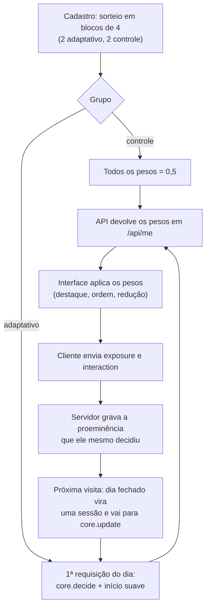

[English](README.en.md) | **Português**

# Gamificação adaptativa

Com base no conceito de **gamificação adaptativa** adotada no capítulo 4 da dissertação "Framework L para desenvolvedores de mHealth no contexto de self-care e gamificação" (Wanderley de Oliveira, 2018) foi criado esse projeto que conta com uma biblioteca, um app e um simulador para pesquisar **gamificação adaptativa**: interfaces gamificadas que se ajustam a cada pessoa a partir do que ela faz, baseado na tipologia Hexad de Marczewski.

> **Status:** projeto de pesquisa em andamento. O motor e o simulador estão prontos e testados; os números do simulador vêm de um **mundo sintético** e não são evidência sobre pessoas reais.
>
> **Idioma:** este README existe em português e em [inglês](README.en.md). O código, os comentários e os identificadores estão em inglês; a interface do app está em português.

## O que é gamificação adaptativa

**Gamificação** é o uso de elementos de jogo (pontos, níveis, ranking, desafios, grupos…) em contextos fora de jogos, para estimular um comportamento, como estudar todo dia. O problema é que **a mesma gamificação para todos funciona mal**: o que motiva uma pessoa pode ser indiferente ou irritante para outra.

**Gamificação adaptativa** muda a interface gamificada para cada pessoa. A pergunta central é: *quais elementos mostrar, quando mostrar e com que destaque, para esta pessoa?*

### A tipologia Hexad

Usamos como base a tipologia **Hexad** de tipos de usuário de gamificação (proposta por Andrzej Marczewski e operacionalizada em escala por Tondello e colegas). Ela descreve seis motivações:

| Tipo | Motivação principal | Elementos típicos |
|---|---|---|
| **Achiever** | Domínio, competência, progresso | níveis, barras de domínio, desafios, conquistas |
| **Player** | Recompensas e ganhos | pontos, ranking, recompensas |
| **Socialiser** | Relacionar-se com outras pessoas | grupos, feed de atividade, estudo em dupla |
| **Free Spirit** | Autonomia e exploração | catálogo para explorar, trilhas livres, personalização |
| **Disruptor** | Mudar o sistema | criar e remixar, votar em funcionalidades, sugerir edições |
| **Philanthropist** | Ajudar sem esperar retorno | compartilhar, responder dúvidas, presentear |

### O que este projeto faz de diferente

1. **O perfil é um vetor de 6 números.** Uma pessoa não está 100% pertencente apenas a um tipo de perfil: ela tem uma mistura, que o sistema estima e atualiza.
2. **Sem questionário.** O perfil é aprendido do comportamento: o que foi exibido, em que a pessoa interagiu e se ela fez o que o app quer incentivar.
3. **A recompensa é o comportamento-alvo do app.** Cliques entram só como um sinal auxiliar pequeno.
4. **Aprende e esquece.** É um bandit contextual (Thompson Sampling linear) com esquecimento, então acompanha mudanças de gosto, devagar.
5. **Nunca esconde um elemento.** O motor devolve pesos de 0 a 1 com um piso; o app decide o que fazer com eles (destacar, reordenar, reduzir).

## O que entregamos

| Parte | O que faz | Onde |
|---|---|---|
| **Core** | Biblioteca TypeScript pura (sem I/O, sem dependências). Recebe eventos de uso e devolve, a cada dia, o peso de cada elemento de gamificação para aquela pessoa | [`packages/core`](packages/core) |
| **App** | "Estudo com cartões": app de flashcards com repetição espaçada, 19 elementos de gamificação (individuais e sociais) | [`packages/app-server`](packages/app-server), [`packages/app-web`](packages/app-web) |
| **Simulador** | Usuários sintéticos com preferências Hexad escondidas, para medir se o motor aprende, e uma página interativa que mostra a interface mudando ao longo dos dias | [`packages/simulator`](packages/simulator) |



## Sumário

1. [Core](#1-core)
2. [App](#2-app)
3. [Simulador](#3-simulador)

**Requisitos:** Node.js 24 ou mais novo (o projeto roda TypeScript direto, sem etapa de compilação, e usa o SQLite embutido do Node). Depois de clonar: `npm install`.

---

## 1. Core

O core é o motor de adaptação. É uma biblioteca **pura**: sem rede, sem disco, sem relógio, sem dependências e sem conhecer nenhum app. Você guarda um pequeno JSON por usuário (o *estado*) e chama funções que devolvem um novo estado.

### Como funciona



Por dentro, para cada pessoa o core mantém uma **crença** sobre o seu perfil Hexad (6 números, com incerteza). Em `decide`, sorteia um perfil plausível dessa crença e pontua cada elemento pela **assinatura Hexad** dele (quanto ele fala a cada tipo); a pontuação vira um peso entre o piso e 1. Em `update`, ajusta a crença com base em qual mistura de elementos a pessoa viu e em qual foi o resultado. O esquecimento faz a crença voltar aos poucos ao ponto neutro quando não há evidência nova..

Resumo do modelo (a crença é `θ ~ N(μ, Σ)`, guardada como `A = Σ⁻¹` e `b = Aμ`; `x` é a mistura das assinaturas normalizadas dos elementos exibidos, ponderada pela proeminência; `r` é a recompensa da sessão):

```text
decide:  θ̃ = μ + v · chol(Σ) · z,   z ~ N(0, I)             v = samplingScale
         s_e = θ̃ · assinatura_e
         peso_e = clamp(0,5 + sensitivity · (s_e − média(s)), exposureFloor, 1)
update:  A ← γA + x xᵀ / σ² + (1−γ) Λ₀                      γ = forgetting, σ² = noiseVariance
         b ← γb + r x / σ² + (1−γ) Λ₀ μ₀
         r = (1−ω) · outcome + ω · taxa_de_interação          ω = interactionRewardWeight
```

Na recompensa, o *nível* médio das seis dimensões age como intercepto (prior praticamente difuso), então o que se aprende é a **diferença** entre os tipos.

### Usando em um projeto

O core ainda **não está publicado no npm**. Por enquanto, copie a pasta [`packages/core/src`](packages/core/src) (6 arquivos, cerca de 750 linhas, sem dependências) ou use o repositório como submódulo, e importe por caminho relativo. Node 24+ e bundlers modernos (Vite, esbuild) leem os `.ts` diretamente.

Um exemplo executável está em [`packages/core/examples/quickstart.ts`](packages/core/examples/quickstart.ts):

```bash
node packages/core/examples/quickstart.ts
```

Os passos, em resumo:

```ts
import { applySoftStart, createEngine, softStartFactor } from './packages/core/src/index.ts';
import type { AdaptiveEvent, Catalog } from './packages/core/src/index.ts';

// 1. O catálogo: seus elementos de gamificação e a "assinatura" Hexad de cada um.
const catalog: Catalog = {
  schemaVersion: '0.1',
  elements: [
    { id: 'points', label: 'Pontos', signature: { achiever: 0.2, player: 0.6, socialiser: 0.05, freeSpirit: 0.05, disruptor: 0.05, philanthropist: 0.05 } },
    { id: 'study_groups', label: 'Grupos', signature: { achiever: 0.05, player: 0.1, socialiser: 0.6, freeSpirit: 0.05, disruptor: 0.05, philanthropist: 0.15 } },
    // ...
  ],
};

// 2. O motor (um por catálogo). `seed` torna as decisões reproduzíveis.
const engine = createEngine({ schemaVersion: '0.1', catalog, seed: 1 });

// 3. Estado da pessoa: um JSON. Crie no cadastro e guarde (banco, arquivo...).
let state = engine.neutralState('user-1');

// 4. Decida. Idempotente por sessionId: chamar de novo devolve os mesmos pesos.
const day = 0;
const decided = engine.decide(state, 'day-0', Date.now()).weights;
// Opcional, recomendado: nos primeiros dias encolha os pesos na direção de 0,5 (veja "Início suave").
const weights = applySoftStart(decided, softStartFactor(day, 7));
// -> renderize a interface: weights['points'] = 0.72 (destaque), weights['study_groups'] = 0.1 (reduzido)...

// 5. Quando a sessão terminar, informe o que realmente aconteceu e aprenda.
const events: AdaptiveEvent[] = [
  { type: 'exposure', userId: 'user-1', sessionId: 'day-0', at: Date.now(), elementId: 'points', prominence: weights['points']! },
  { type: 'interaction', userId: 'user-1', sessionId: 'day-0', at: Date.now(), elementId: 'points' },
  { type: 'outcome', userId: 'user-1', sessionId: 'day-0', at: Date.now(), value: 0.8 }, // o comportamento que você quer incentivar, de 0 a 1
];
state = engine.update(state, events).state; // devolve um estado NOVO; o antigo não é alterado
```

### API

```ts
createEngine(config: EngineConfig): AdaptiveEngine
```

| Método | Quando chamar | O que faz |
|---|---|---|
| `neutralState(userId)` | no cadastro | Estado inicial neutro: nenhum perfil assumido (as seis dimensões iguais), com incerteza alta |
| `decide(state, sessionId, at)` | no início de cada sessão | Devolve `{ weights, state, reused }`. Pesos em `[exposureFloor, 1]`. **Idempotente por `sessionId`** |
| `update(state, events)` | quando sessões terminam | Aprende de **sessões completas** (exposição + interação + resultado no mesmo lote). Devolve `{ state, processedSessions, skippedSessions, warnings }`. Idempotente por `sessionId` |
| `explain(state)` | para depuração ou exibição | `{ profile, level, uncertainty, sessionsObserved }`: perfil estimado (diferenças entre os 6 tipos), nível médio da recompensa e incerteza |

**Eventos** (`AdaptiveEvent`), todos com `userId`, `sessionId` e `at` (milissegundos):

| `type` | Campos | Significado |
|---|---|---|
| `exposure` | `elementId`, `prominence` (0 a 1) | O elemento foi **realmente exibido**, com esta proeminência. É o que define o contexto da sessão; registre o que foi mostrado, não só o que foi decidido |
| `interaction` | `elementId` | A pessoa interagiu com o elemento (sinal auxiliar, peso pequeno) |
| `outcome` | `value` (0 a 1), `kind?` | O comportamento-alvo do app nesta sessão, ex.: fração da fila de estudo concluída |

**Configuração** (`EngineConfig`): só `schemaVersion`, `catalog` e, de preferência, `seed` são obrigatórios. Os padrões foram calibrados no simulador (veja `calibrate.ts` em `packages/simulator/src`); a lista completa está em [`types.ts`](packages/core/src/types.ts) e `DEFAULTS`.

| Parâmetro | Padrão | Efeito |
|---|---|---|
| `forgetting` | 0,98 | Quanto a crença esquece por sessão. Menor = acompanha mudanças mais rápido, com mais ruído |
| `sensitivity` | 16 | Quão longe do 0,5 os pesos vão para uma diferença de pontuação. Maior = interface mais contrastada |
| `exposureFloor` | 0,1 | Nenhum elemento fica abaixo disso |
| `samplingScale` | 0,15 | Quanto o sorteio explora. Baixo = quase guloso e estável |
| `interactionRewardWeight` | 0,05 | Peso dos cliques na recompensa (o resto é o `outcome`) |
| `priorVariance`, `levelPriorVariance`, `noiseVariance` | 0,5; 100; 0,05 | Prior e ruído do modelo |
| `seed` | 0 | Semente do gerador determinístico |

### Boas práticas e cuidados

- **Registre o que foi exibido.** `exposure` deve refletir a interface de fato, inclusive quando você suaviza ou limita os pesos.
- **Escolha bem o `outcome`.** O motor otimiza o que você mandar. Use o comportamento que você quer incentivar, não cliques.
- **Início suave.** Mesmo com crença neutra, a primeira decisão sorteada pode ser extrema (vários elementos no máximo e vários no piso). `softStartFactor` e `applySoftStart` encolhem os pesos na direção de 0,5 nos primeiros dias, crescendo de 25% a 100%.
- **Estado serializável.** `UserState` é JSON puro; guarde-o como quiser. Os formatos têm JSON Schemas em [`spec/schemas`](spec/schemas) para validar entrada e saída.
- **Determinismo.** Mesmo estado, mesma semente e mesmos eventos dão sempre o mesmo resultado, o que torna os testes simples.
- **Seu catálogo, suas assinaturas.** As assinaturas Hexad são *priors* da literatura e do julgamento da equipe. Veja o catálogo de exemplo em [`spec/catalog.flashcards.json`](spec/catalog.flashcards.json). Variantes diferentes da mesma estratégia devem ser elementos diferentes.
- **Limite conhecido:** o acompanhamento de uma mudança de gosto é lento (dezenas de dias), e a história de uma única pessoa é ruidosa. Veja a seção do simulador.

```bash
npm test             # core, app e simulador (107 testes)
npx tsc -p tsconfig.json   # checagem de tipos
```

---

## 2. App

**"Estudo com cartões"** é um app web de flashcards usado como ambiente real de pesquisa: tem um objetivo claro (estudar todo dia), um comportamento mensurável (concluir a fila do dia) e muitos elementos de gamificação que podem ser destacados ou reduzidos.

### O que ele faz

- **Estudo:** repetição espaçada (SM-2 simplificado, notas Errei/Difícil/Bom/Fácil), até 10 cartões novos por dia distribuídos entre os baralhos, estudo em duas etapas (escolher baralhos, depois estudar).
- **Biblioteca:** baralhos públicos de exemplo, criar, remixar, trilhas livres, explorar o catálogo.
- **19 elementos de gamificação**, três ou mais para cada tipo Hexad:

| Tipo | Elementos |
|---|---|
| Achiever | níveis, barra de domínio por baralho, desafios diários, conquistas |
| Player | pontos, ranking semanal, recompensas cosméticas |
| Socialiser | grupos de estudo, feed de atividade, estudo em dupla |
| Free Spirit | explorar o catálogo, trilhas não lineares, avatar e tema |
| Disruptor | criar e remixar baralhos, votar em funcionalidades, sugerir edições |
| Philanthropist | compartilhar baralhos, responder dúvidas, presentear colegas |

- **Sem punição:** nenhum elemento tira pontos, sequência ou nível.
- **Pesquisa:** registra eventos de exposição e interação, com exportação anonimizada em CSV.
- **Acesso pseudônimo:** código gerado + senha opcional. Não há e-mail nem nome real.

### Como rodar

```bash
npm install
npm run build:web    # compila a interface (uma vez, e depois de mudar o front-end)
npm run start        # http://localhost:8787
```

No Windows, use `npm.cmd` se o PowerShell bloquear scripts, ou dê dois cliques em `iniciar.bat`. Em desenvolvimento, `npm run dev:server` e `npm run dev:web` reiniciam ao salvar.

| Variável | Padrão | Para quê |
|---|---|---|
| `PORT` | 8787 | Porta do servidor |
| `DATA_PATH` | `./data/app.db` | Arquivo do banco SQLite (criado na primeira execução, com conteúdo de exemplo) |
| `EXPERIMENT` | desligado | `on` liga o experimento A/B com a gamificação adaptativa |
| `ENGINE_SEED` | 1 | Semente do motor |
| `RAMP_DAYS` | 7 | Dias do início suave do grupo adaptativo (1 desliga) |
| `SECURE_COOKIES` | desligado | `1` para uso atrás de HTTPS |

Outros comandos: `npm run export` (eventos de pesquisa anonimizados em `data/export/`) e `npm run admin -- proposals|suggestions` (ideias mais votadas e sugestões de edição).

### Como ele se conecta ao core

Essa aplicação foi pensada para que o conceito de **gamificação adaptativa** pudesse ser avaliado em um experimento A/B. Com o experimento **desligado** (padrão), todos veem a mesma interface, com todos os pesos em 0,5. Com `EXPERIMENT=on`:



Pontos de projeto que importam para a pesquisa:

- **A unidade de adaptação é o dia de estudo.** A decisão é tomada na primeira requisição do dia e vale para todas as visitas.
- **O resultado é a fração da fila concluída** no dia, creditada à primeira sessão do dia.
- **O servidor decide e registra a proeminência.** O cliente não consegue falsificar a exposição, e **nunca recebe o seu grupo**.
- **Se o core falhar**, a pessoa recebe pesos uniformes e o app continua funcionando.
- **Pesos viram interface:** peso ≥ 0,7 é destaque (borda e vem antes na grade); ≤ 0,3 é reduzido (só o título e "Ver detalhes", nunca some); entre os dois é normal. A ordem segue o peso. A regra está em [`presentation.ts`](packages/app-web/src/presentation.ts), compartilhada com o simulador.

### Qual o impacto da gamificação adaptativa neste app

O impacto é **o que muda na tela**, e o que se espera disso é uma **hipótese a testar**:

| | Grupo controle | Grupo adaptativo |
|---|---|---|
| Interface | A mesma para todos | Cada pessoa vê em destaque os elementos que o motor estima que combinam com ela, e os demais reduzidos |
| O que muda | Nada | Quais elementos aparecem com destaque, em que ordem, e quais ficam compactos; muda de um dia para o outro |
| Dado coletado | Exposição, interação, resultado diário | O mesmo, mais o perfil estimado e a incerteza dia a dia |
| O que se compara | Concluir a fila do dia, retenção, uso | Idem |

No simulador, com um mundo em que o encaixe entre elemento e perfil importa por construção, o ganho esperado sobre a interface uniforme é de **cerca de 5 pontos percentuais** de conclusão (de 42% para 47%), contra 12 pontos de um oráculo que conhecesse o perfil. Isso mostra que o mecanismo funciona se o efeito existir; **não** mostra que ele existe em pessoas reais. É isso que o experimento (com aprovação ética) vai medir.

Limitações a ter em mente: os elementos sociais só são exibidos a quem abre a aba Comunidade (viés de posição); o grupo adaptativo usa início suave de 7 dias; e os parâmetros do motor foram calibrados só em mundos sintéticos e devem ser reestimados com dados do piloto.

---

## 3. Simulador

O simulador responde a uma pergunta antes de qualquer pessoa usar o app: **dado um usuário com preferências Hexad escondidas, o motor consegue descobri-las a partir de sinais ruidosos e melhorar o resultado?** Ele usa o mesmo core do app.

### O que ele faz

- **Mundo sintético** ([`sim.ts`](packages/simulator/src/sim.ts)): cada usuário falso tem uma afinidade escondida com cada tipo Hexad e uma chance base de concluir a fila. A interface do dia desloca essa chance conforme o encaixe com a afinidade, com ruído diário. Há elementos "brilhantes" que atraem cliques sem melhorar o resultado, para testar a armadilha de otimizar cliques.
- **Políticas comparadas:** uniforme (controle), aleatória, oráculo (conhece o perfil), Hexad (o core) e um bandit direto sobre os elementos, com as mesmas sementes e o mesmo ruído para comparar justamente.
- **Experimentos da F2** (`npm run sim`): verifica os seis critérios de pronto do projeto e escreve um relatório.
- **Calibração** ([`calibrate.ts`](packages/simulator/src/calibrate.ts)): busca de parâmetros com validação em mundos que a busca não viu.
- **Página visual**: um usuário falso vivendo dias no app, com controle do tempo.

### Como usar

```bash
npm install
npm run sim          # experimentos da F2 (300 usuários por política); SIM_USERS=60 para uma rodada rápida
                     # escreve o relatório em docs/SIMULACAO_F2_RESULTADOS.md (pasta local, não versionada)
node packages/simulator/src/calibrate.ts   # calibração (CAL_QUICK=1 para um teste rápido); escreve docs/CALIBRACAO_F2_RESULTADOS.md (local)
npm run sim:web      # página visual em http://localhost:5174 (ou dê dois cliques em iniciar-simulacao.bat)
```

**A página visual** permite:

- escolher o usuário falso (um perfil Hexad pronto ou uma mistura qualquer) e ajustar o mundo (efeito da interface, ruído, chance base, duração, início suave);
- **controlar o tempo**: reproduzir, pausar, passo a passo, +7 dias, arrastar a barra e acelerar de 1 a 40 dias por segundo;
- ver a **interface adaptativa lado a lado com a uniforme**, com os elementos em destaque, normais e reduzidos, e em quais o usuário clicou;
- comparar a **afinidade real escondida** com o **perfil que o sistema estimou**;
- ver o peso de cada elemento ao longo de todos os dias (mapa de calor);
- simular **uma mudança de gosto** no meio do caminho;
- simular **30 vidas** do mesmo usuário e ver a média, porque a história de uma pessoa é ruidosa.

### O que ele traz de informação

Resultados com os padrões calibrados, 300 usuários sintéticos por política, 120 dias (`npm run sim` reproduz e gera o relatório completo):

| Pergunta | Resposta |
|---|---|
| O motor aprende o perfil começando do neutro? | **Sim.** Correlação média com o perfil escondido de ≈ 0,6 no dia 120; o tipo dominante é identificado em 62% dos casos (acaso: 17%) |
| Melhora o resultado? | **Sim, em média.** Ganho de ≈ 0,049 sobre a interface uniforme (o oráculo chega a 0,123). A distância até o oráculo vem do custo de aprender e do ruído |
| Acompanha uma mudança de gosto? | **Parcialmente e devagar.** Dezenas de dias para recuperar parte da correlação |
| Otimizar cliques serve? | **Não.** Só com cliques como recompensa, o ganho de resultado cai de 0,050 para 0,012 |
| Algum elemento some? | **Não.** O piso é respeitado em todas as decisões |
| A camada Hexad vale a pena? | **Depende do mundo.** Ganha de um bandit direto quando a estrutura Hexad existe, mesmo com assinaturas imprecisas; perde quando o efeito individual de cada elemento é forte |
| Quanto a interface muda por dia? | Em média 0,16 de peso por elemento; é visível. Reduzir isso custa ganho |

**Como ler:** o mundo foi definido por nós, e nele o efeito do tipo Hexad existe por construção. Os números verificam o **comportamento do algoritmo**, não o comportamento de pessoas. Não cobrem efeito de novidade, abandono, mudança gradual de gosto nem mais de uma sessão por dia.

Para estender: crie novas políticas em `sim.ts` (`PolicyFactory`), mude os parâmetros do mundo (`WorldParams`) ou troque o catálogo em [`spec/`](spec).

---

## Estrutura do repositório

| Pasta | Conteúdo |
|---|---|
| `packages/core/` | O motor, exemplo e testes |
| `packages/app-server/` | API, banco, repetição espaçada, gamificação, experimento |
| `packages/app-web/` | Interface React |
| `packages/simulator/` | Mundo sintético, experimentos, calibração e página visual |
| `spec/` | JSON Schemas, catálogo de flashcards e exemplos de eventos |

## Comandos

```bash
npm install
npm test             # 107 testes (core, app, simulador)
npx tsc -p tsconfig.json
npm run sim          # experimentos do simulador
npm run sim:web      # página visual
npm run build:web && npm run start   # app
npm run export       # exporta os eventos de pesquisa
```

## Licença

Código sob a licença [MIT](LICENSE).

Os resultados do simulador vêm de um mundo sintético; veja as ressalvas na seção [Simulador](#3-simulador) antes de citá-los.
